# eventHandler : guide d'utilisation

_eventHandler_ ajoute à Dotclear un nouveau type de contenu : les **événements** (réunion, concert, atelier…). Un événement a une date de début, une date de fin et un lieu. Des billets peuvent lui être liés. Le plugin fournit aussi des pages publiques (liste, calendrier, carte, flux) et des widgets.

## Sommaire

1. [Activer le plugin](#activer-le-plugin)
2. [Configurer le plugin](#configurer-le-plugin)
3. [La liste des événements](#la-liste-des-événements)
4. [Créer ou modifier un événement](#créer-ou-modifier-un-événement)
5. [Lier des billets et des événements](#lier-des-billets-et-des-événements)
6. [Pages publiques](#pages-publiques)
7. [Widgets](#widgets)

## Activer le plugin

Allez dans **Système › Gestion des plugins**, déroulez _eventHandler_ puis cliquez sur **Configurer le plugin**. Cochez **Activer le plugin** et enregistrez : les autres réglages apparaissent.

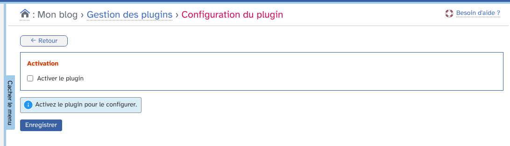

Un menu **Gestionnaire d'événements** apparaît alors dans la barre latérale.

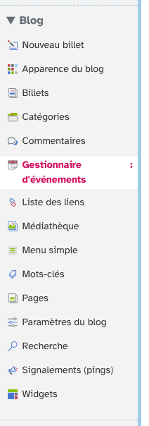

## Configurer le plugin

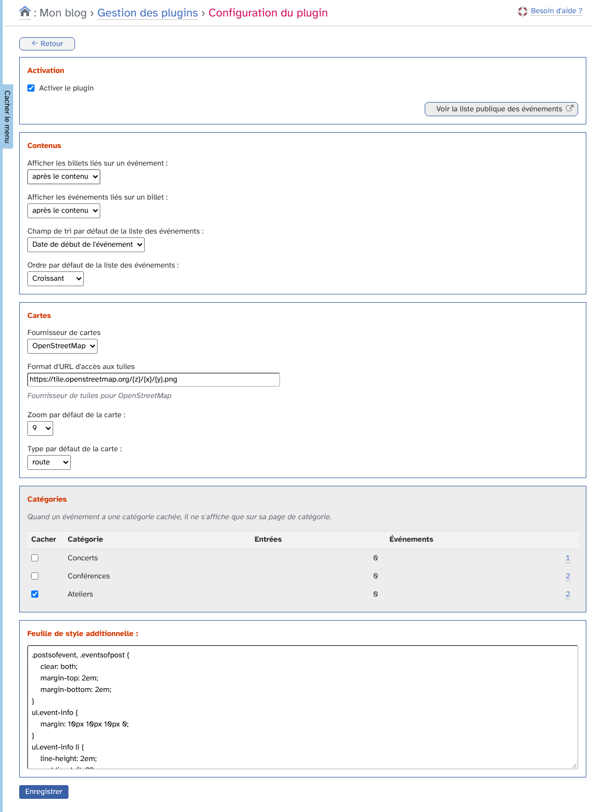

- **Contenus** : où afficher les billets liés sur un événement, et les événements liés sur un billet (avant le contenu, après le contenu, ou cacher). Vous choisissez aussi le champ de tri et l'ordre par défaut de la liste publique.
- **Cartes** : fournisseur (OpenStreetMap ou GoogleMaps), zoom et type de carte par défaut.
- **Catégories** : cochez les catégories dont les événements ne doivent s'afficher que sur leur page de catégorie.
- **Feuille de style additionnelle** : votre CSS pour les pages publiques.

## La liste des événements

Le menu **Gestionnaire d'événements** affiche tous les événements.

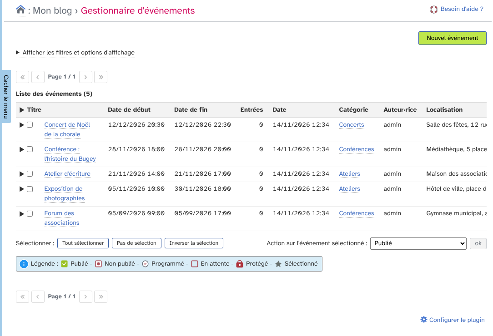

Le bouton **Afficher les filtres et options d'affichage** permet de filtrer par période, catégorie, statut, etc.

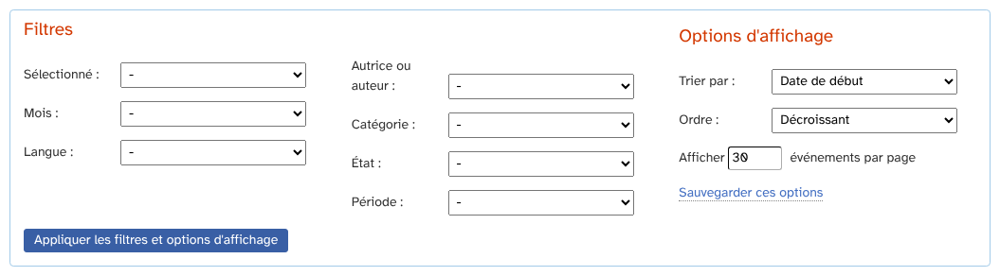

Sélectionnez des événements pour appliquer une action : changer le statut, la catégorie, l'auteur, supprimer, ou les lier à des billets.

## Créer ou modifier un événement

Cliquez sur **Nouvel événement**. L'écran ressemble à celui d'un billet (titre, contenu, catégorie, statut), avec en plus les dates de début et de fin et la localisation (adresse ou carte).

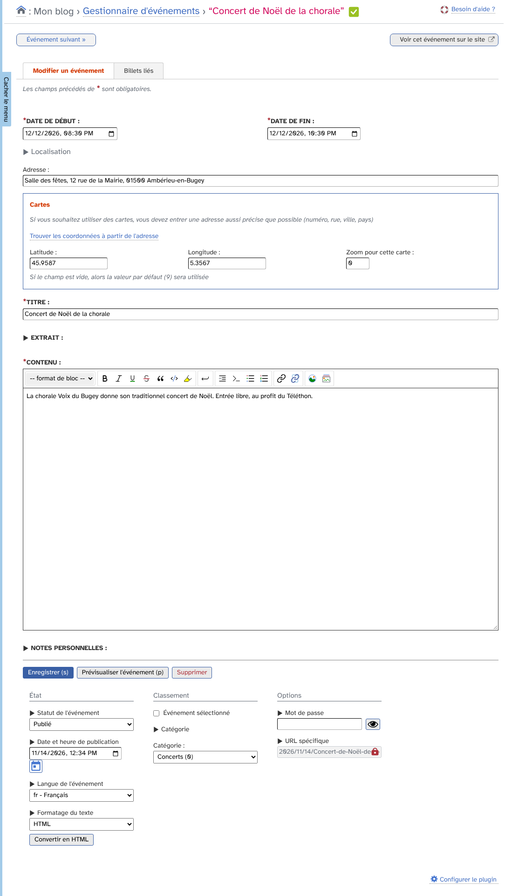

## Lier des billets et des événements

Depuis un événement, le bloc de liaison permet de lui attacher des billets.

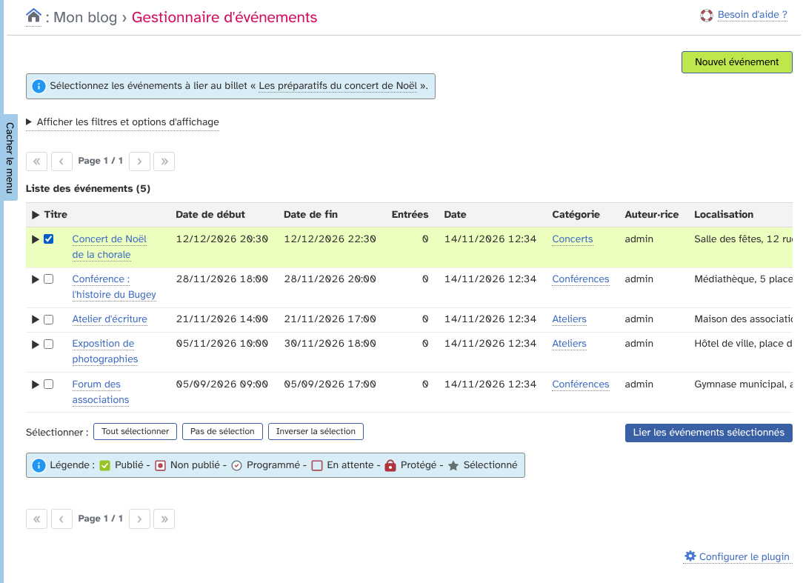

Depuis un billet, le bloc d'événements permet de l'attacher à des événements.

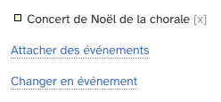

Depuis la liste des billets, l'action **Attacher des événements** lie plusieurs billets d'un coup.

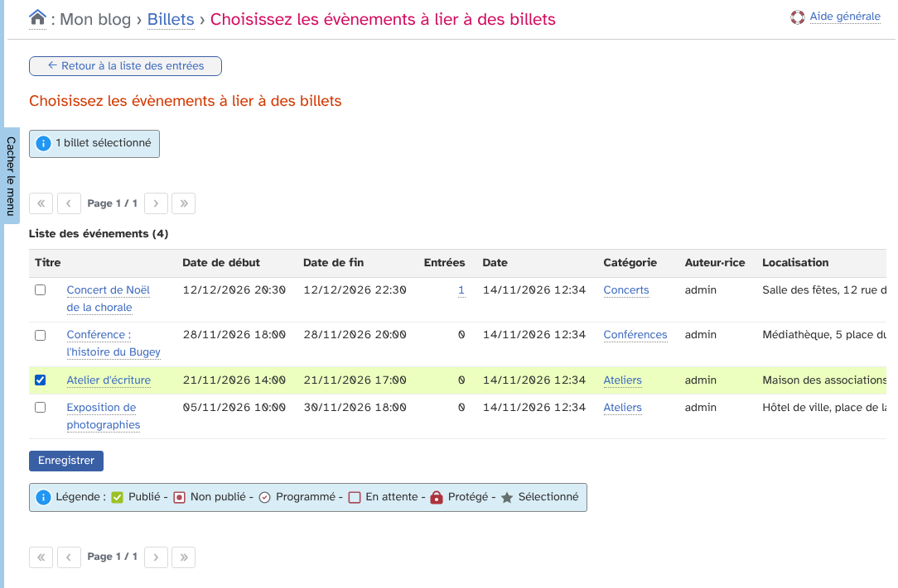

Les billets liés apparaissent sur la page de l'événement.

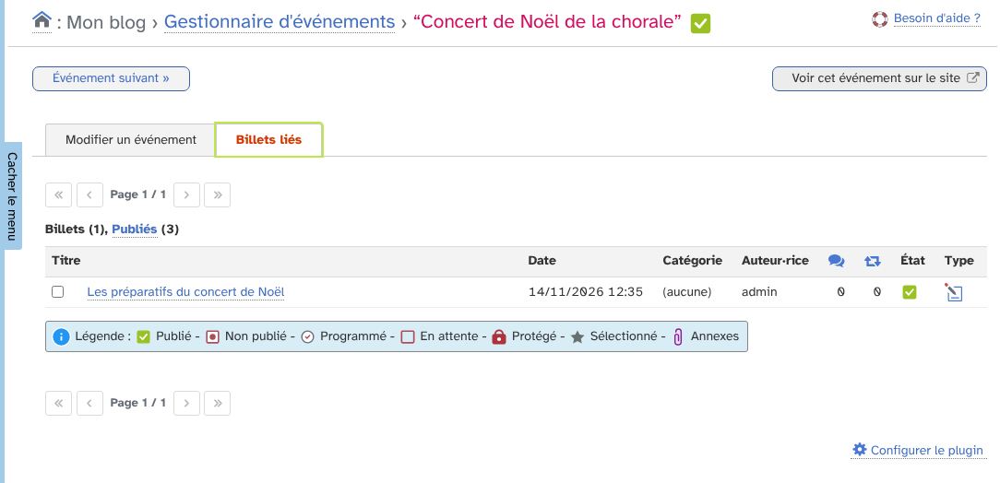

## Pages publiques

La liste publique des événements est accessible à l'adresse `/days` de votre blog ; elle propose le fil Atom, iCalendar, hCalendar et une carte.

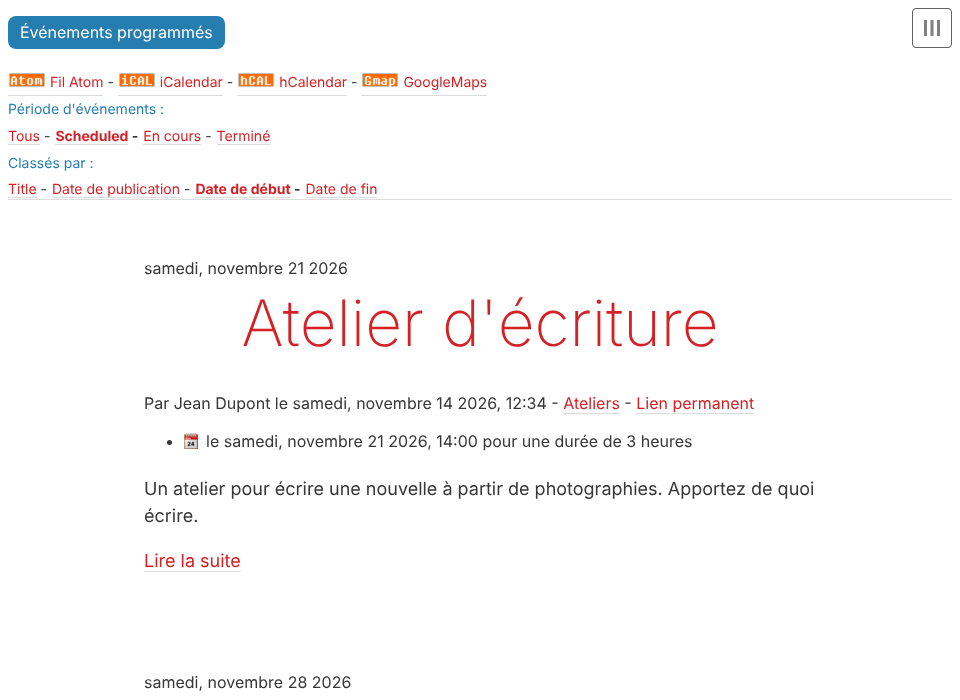

Chaque événement a sa page, avec ses dates, son lieu et ses billets liés.

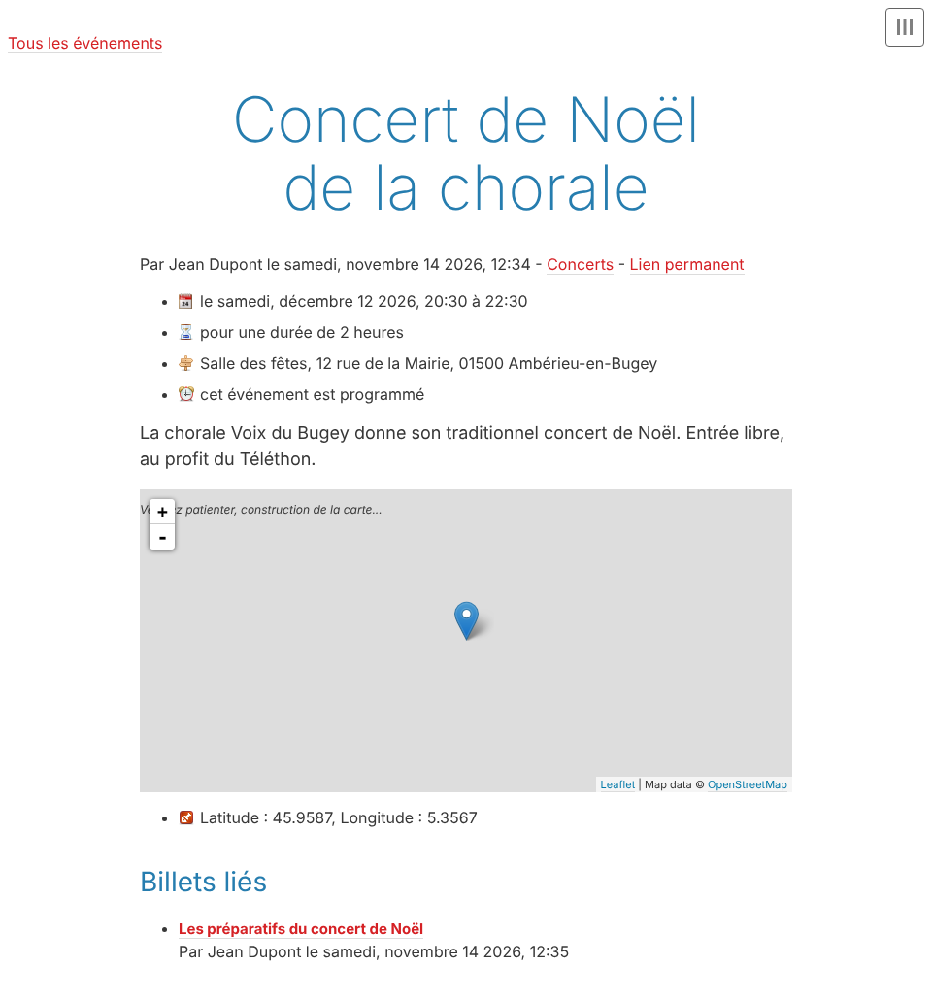

## Widgets

Dans **Apparence du blog › Widgets**, trois widgets sont disponibles : prochains événements, calendrier des événements et événements par catégorie.

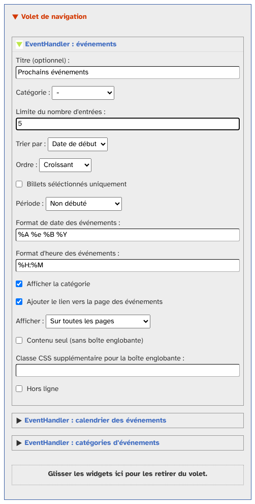

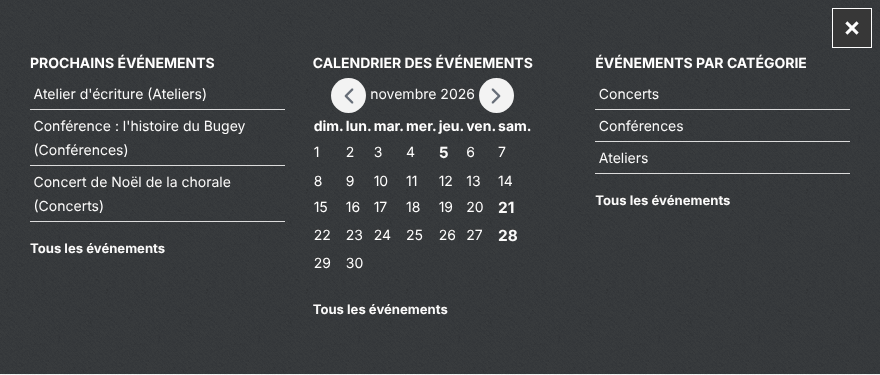
